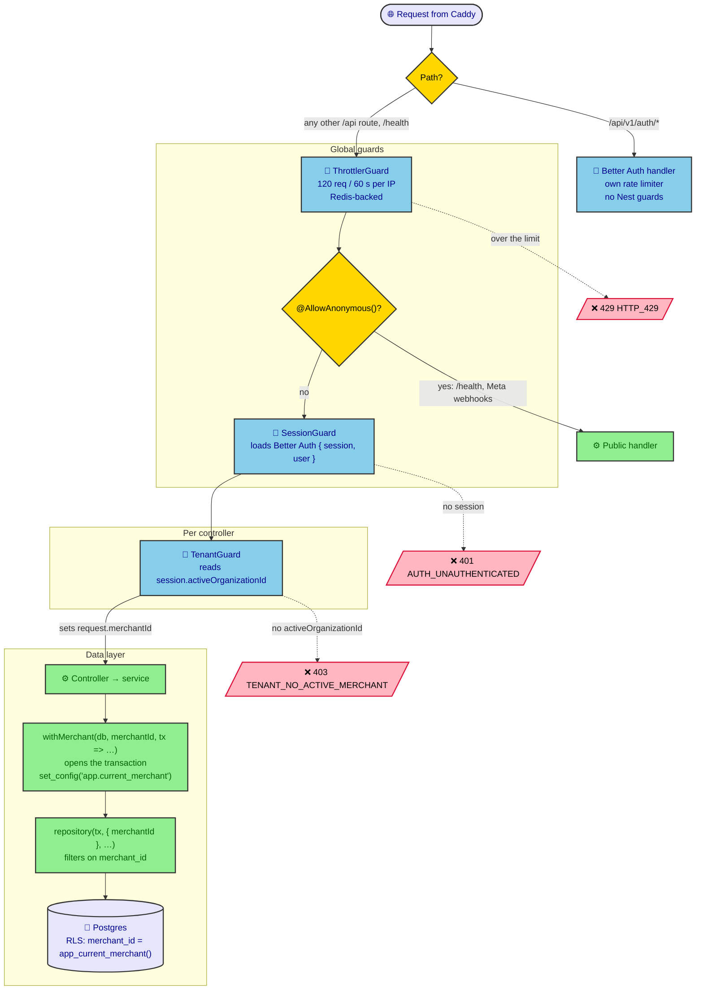

# Request pipeline

The path an API request takes from Caddy to the database. See
[01 · Authentication](README.md#request-pipeline) for what each guard does.

Solid arrows are the path a request takes when it passes. Dotted arrows are
rejections, each sent in the API's `{ error: { code, message, params } }`
envelope.

Better Auth mounts `/api/v1/auth/*` outside Nest routing, so none of the Nest
guards run for it. The throttle limit is the default. A few routes set a
tighter `@Throttle()`, and the Messenger webhook and the conversations
event stream opt out with `@SkipThrottle()`.
