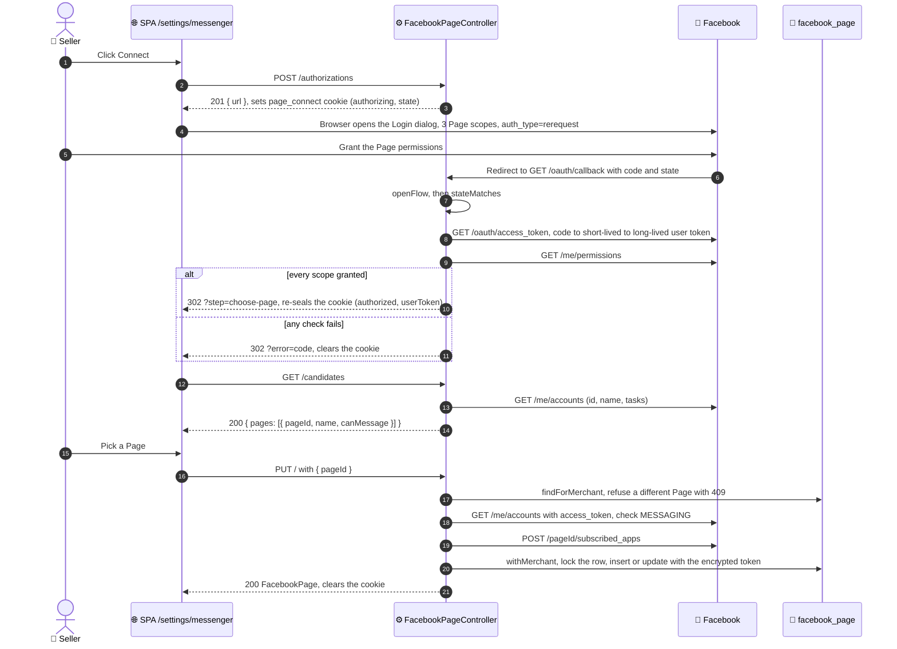

# Connect flow

The requests a seller's browser, the API, and Facebook exchange to connect a
Page. See [03 · Connect Facebook Page](README.md) for the routes, the error
codes, and the rules behind each step.

Every route, the callback included, runs behind `SessionGuard` and
`TenantGuard`. The `page_connect` cookie carries the flow between requests,
so the API keeps no flow state of its own.

Graph calls run outside any transaction. The connect step makes two short
transactions: a read before Facebook is called, and the write after. The
write takes a row lock and re-checks the shop's Page, so two connects in
parallel cannot both succeed.
