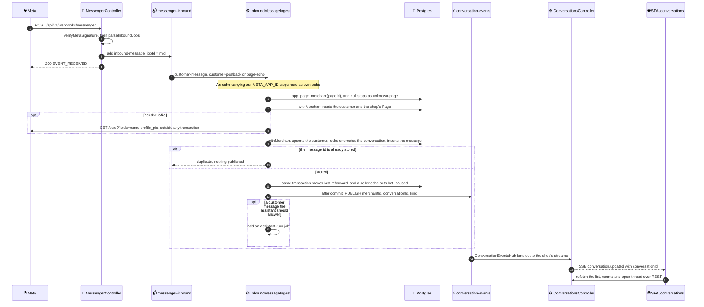
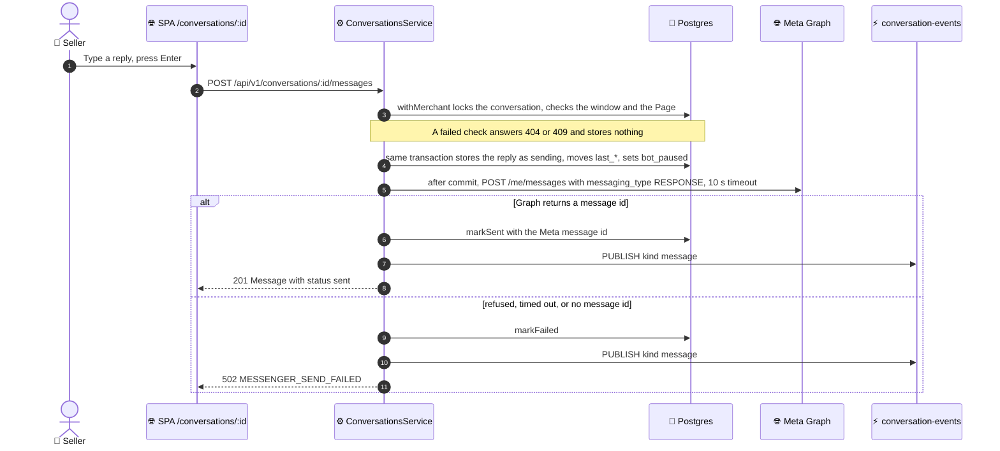

# Message flow

How a Messenger message reaches the seller's dashboard, and how a seller's
reply goes out. See [04 · Conversations](README.md) for the routes, the error
codes, and the rules behind each step.

## A customer message

The worker runs steps 5 to 13. The webhook does no database work, so Meta
gets its `200` before the message is stored. `PUT /:id/read`, `PATCH /:id`,
`POST /:id/messages`, `DELETE /:id/messages/:messageId` and the assistant's
sends publish to the same channel after their own commits.

## A seller reply

No transaction is open during the Graph call. A failed reply stays in the
thread, and the assistant stays paused. Meta echoes a delivered reply back to
the webhook with our app id, and the ingest skips it as `own-echo`.
