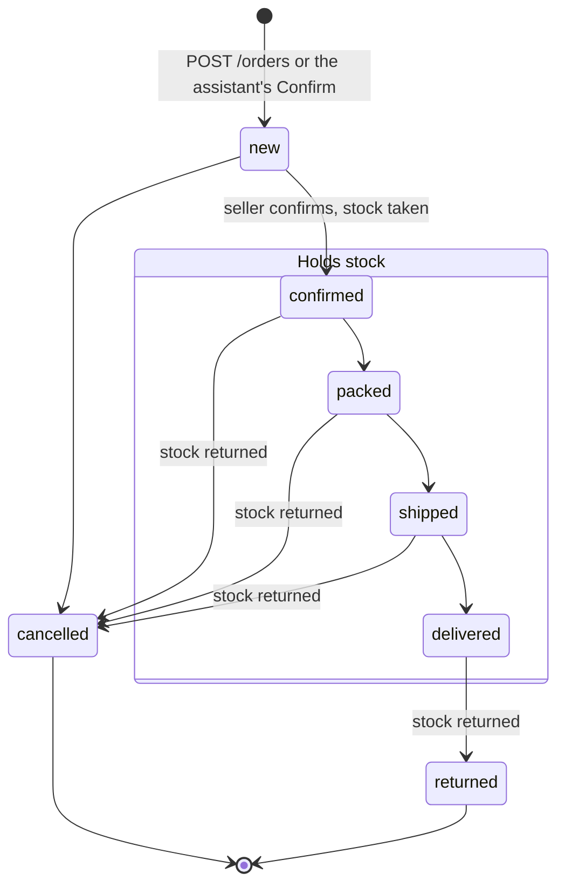

# Order lifecycle

The statuses an order moves through, and what each move does to stock. See
[07 · Orders](README.md) for the routes and the rules behind each step.

## Statuses

`canTransitionOrder` in
[`packages/shared/src/schemas/order.ts`](../../../packages/shared/src/schemas/order.ts)
allows exactly these moves. Any other is `409 ORDER_INVALID_TRANSITION`.

Stock follows `orderHoldsStock`: an order in `confirmed`, `packed`, `shipped`
or `delivered` holds its items' stock. A move between two holding statuses
moves no stock. A move into one takes stock, and a move out of one gives it
back. Taking more than a variant has is `409 ORDER_INSUFFICIENT_STOCK`, and
the whole change rolls back.

## What can change in each status

| Status      | Items (`PUT /:id/items`) | Delivery details (`PATCH /:id`) | Payment, tracking, note |
| ----------- | ------------------------ | ------------------------------- | ----------------------- |
| `new`       | yes                      | yes                             | yes                     |
| `confirmed` | yes, stock follows       | yes                             | yes                     |
| `packed`    | no                       | yes                             | yes                     |
| `shipped`   | no                       | no                              | yes                     |
| `delivered` | no                       | no                              | yes                     |
| `returned`  | no                       | no                              | yes                     |
| `cancelled` | no                       | no                              | yes                     |

A refused edit is `409 ORDER_NOT_EDITABLE` with the order's `status`
(`orderItemsEditable` and `orderDeliveryEditable` in `@app/shared`).
