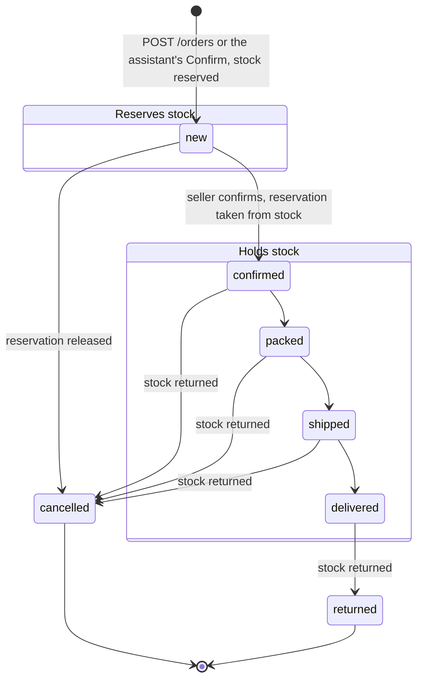

# Order lifecycle

The statuses an order moves through, and what each move does to stock. See
[07 · Orders](README.md) for the routes and the rules behind each step.

## Statuses

`canTransitionOrder` in
[`packages/shared/src/schemas/order.ts`](../../../packages/shared/src/schemas/order.ts)
allows exactly these moves. Any other is `409 ORDER_INVALID_TRANSITION`.

Stock follows `orderStockHold`: a `new` order reserves its items, an order
in `confirmed`, `packed`, `shipped` or `delivered` has taken them, and a
`cancelled` or `returned` one holds nothing. Each variant keeps `stock` (on
hand) and `reserved`; what can be drafted or confirmed is `stock − reserved`.
A move between two taking statuses moves nothing. Confirming turns the
reservation into stock taken, cancelling a draft releases it, and cancelling
or returning a confirmed order gives the stock back. Drafting more than is
available is `409 ORDER_INSUFFICIENT_STOCK`, and the whole change rolls
back.

## What can change in each status

| Status      | Items (`PUT /:id/items`) | Delivery details (`PATCH /:id`) | Payment, tracking, note |
| ----------- | ------------------------ | ------------------------------- | ----------------------- |
| `new`       | yes, reservation follows | yes                             | yes                     |
| `confirmed` | yes, stock follows       | yes                             | yes                     |
| `packed`    | no                       | yes                             | yes                     |
| `shipped`   | no                       | no                              | yes                     |
| `delivered` | no                       | no                              | yes                     |
| `returned`  | no                       | no                              | yes                     |
| `cancelled` | no                       | no                              | yes                     |

A refused edit is `409 ORDER_NOT_EDITABLE` with the order's `status`
(`orderItemsEditable` and `orderDeliveryEditable` in `@app/shared`).
