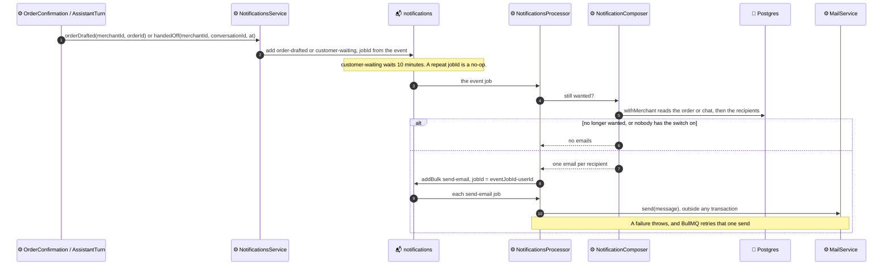
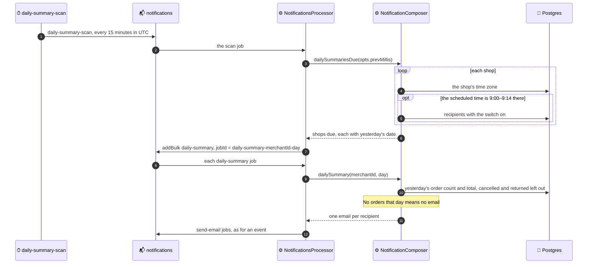

# Sending flow

How an event becomes seller emails. See
[10 · Settings – Notifications](README.md) for each email's conditions and the
switches that gate them.

## An event email

New order drafted and customer waiting take the same path. The caller
reports the event only after its transaction commits.

## The daily summary

