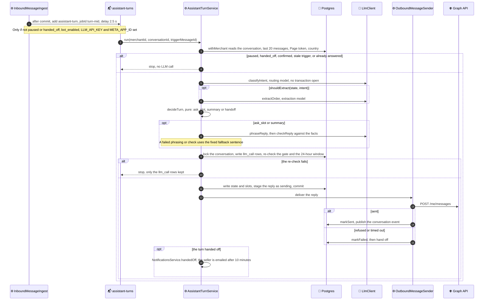

# Turn flow

One assistant turn, from a stored customer message to the reply. See
[11.1 · Foundation](README.md) for the rules behind each step, and
[Conversations' message flow](../../04-conversations/message-flow.md) for how
the message is stored.

An LLM error or timeout, output that fails Zod, confidence under 0.6, a
`complain` or `request_human` intent, or a third ask for one slot all end in
`decideTurn` returning `handoff` (no LLM configured counts as a failed call),
which sends the fixed hand-off sentence with no phrasing call.
