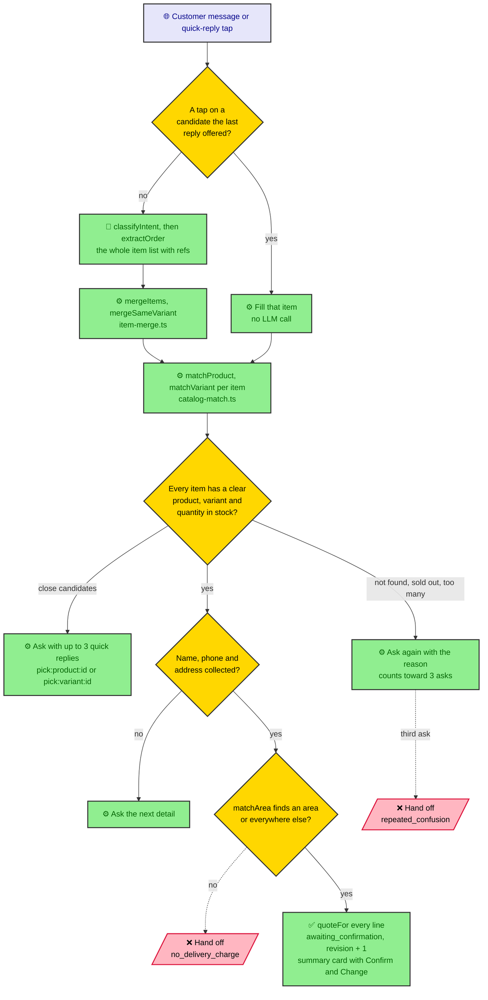
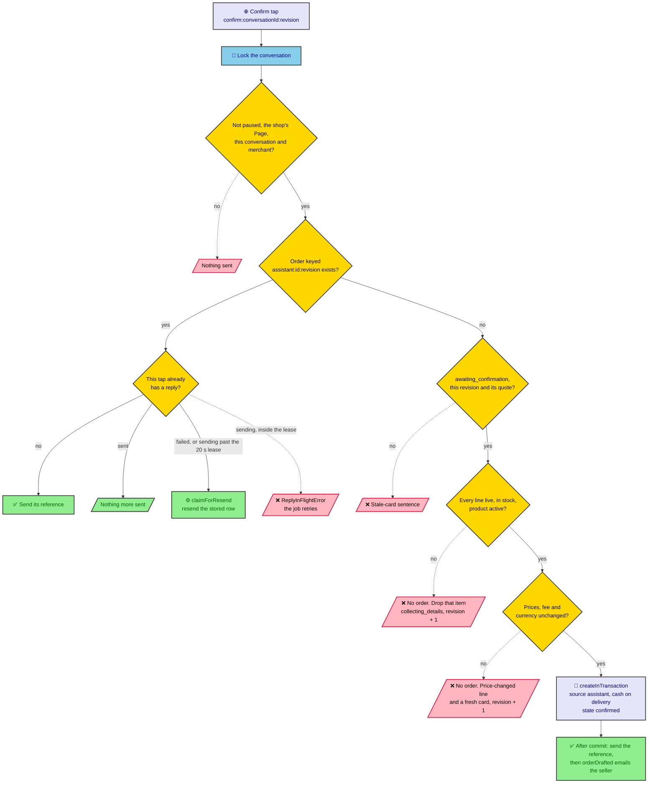

# Confirm flow

How a message becomes a summary card, and how a Confirm tap becomes one
order. See [11.2](README.md#confirm) for the rules behind each step, and
[phase 1's turn flow](../phase-1-foundation/turn-flow.md) for the turn
around the matching.

## From a message to the card

What phase 2 adds inside phase 1's turn, between the read and the write.

## A Confirm tap

`OrderConfirmationService.run`, in one transaction under the conversation
lock. Nothing in it calls the LLM.

A **Change** tap on the current card moves the chat to `collecting_details`
with `revision + 1` and asks what to change; on any other card it gets the
stale sentence.
