# AI implementation progress

Where each phase of [11 · AI implementation](README.md) stands against its
"Done when" list. Update this page in the same change that moves a phase,
and tick an item only once it has been run, not when the code merely exists.

**As of Oct 13, 2026:** 2 of 9 phases built. Both wait on one manual run on
the dev Page with a real `LLM_API_KEY`. Phases 3 to 9 are not started. The MVP
ends Dec 11; App Review is due by Oct 18.

## Summary

| #   | Phase                                                                         | Status      | Done when | Next step                                                 |
| --- | ----------------------------------------------------------------------------- | ----------- | --------- | --------------------------------------------------------- |
| 1   | [Foundation](phase-1-foundation/README.md)                                    | Built       | 3 of 4    | Manual run on the dev Page, with a good key and a bad one |
| 2   | [Catalog matching, Confirm, orders](phase-2-catalog-confirm-orders/README.md) | Built       | 3 of 4    | Manual run from "I want the red saree" to a drafted order |
| 3   | [Entry points](phase-3-entry-points/README.md)                                | Not started | 0 of 3    | Start after phases 1 and 2 pass their manual runs         |
| 4   | [Non-text events](phase-4-non-text-events/README.md)                          | Not started | 0 of 2    |                                                           |
| 5   | [Shared posts and ads](phase-5-shared-posts/README.md)                        | Not started | 0 of 2    | Needs `pages_read_engagement` from App Review             |
| 6   | [Product photos](phase-6-product-photos/README.md)                            | Not started | 0 of 2    |                                                           |
| 7   | [Comments to Messenger](phase-7-comments-to-messenger/README.md)              | Not started | 0 of 1    | First to cut if the schedule slips, after 9 and 8         |
| 8   | [Live-sale comments](phase-8-live-sale-comments/README.md)                    | Not started | 0 of 1    | Second to cut                                             |
| 9   | [Mentions and visitor posts](phase-9-mentions-visitor-posts/README.md)        | Not started | 0 of 1    | First to cut                                              |

```mermaid
flowchart LR
    p1["✅ 1 · Foundation"]:::built --> p2["✅ 2 · Matching, Confirm, orders"]:::built
    p2 --> p3["3 · Entry points"]:::todo
    p3 --> p4["4 · Non-text events"]:::todo
    p4 --> p5["5 · Shared posts"]:::todo
    p5 --> p6["6 · Product photos"]:::todo
    p6 --> p7["7 · Comments"]:::cut
    p7 --> p8["8 · Live-sale comments"]:::cut
    p8 --> p9["9 · Mentions"]:::cut

    classDef built fill:#90EE90,stroke:#333,stroke-width:2px,color:#006400
    classDef todo  fill:#E6E6FA,stroke:#333,stroke-width:2px,color:#00008B
    classDef cut   fill:#FFD700,stroke:#333,stroke-width:2px,color:#000
```

Green is built, lavender is not started, and yellow marks the phases cut
first, from 9 backwards, if the schedule slips. Phases 1 and 2 cannot be cut.

## Phase checklists

Copied from each phase's "Done when". The automated checks were last run on
Oct 13, 2026: `pnpm --filter @app/shared build`, `pnpm typecheck`,
`pnpm lint` and `pnpm test` all pass (120 suites, 1,244 tests). The two
skipped suites are opt-in: the matcher sweep (`MATCH_SWEEP=1`) and the
live-model eval (`LLM_EVAL=1` with `LLM_API_KEY`).

### 1 · Foundation

- [x] Shared build, typecheck, lint and tests pass.
- [x] Schema loop for `llm_call`: migrations `0031_llm_call` and
      `0032_llm_call_force_rls`, which `db:verify-rls` checks.
- [ ] Manually, with a real `LLM_API_KEY`: a message to the dev Page gets an
      AI reply, the turn shows in Bull Board, and an `llm_call` row is
      written. With a bad key, the conversation goes to `handed_off` with the
      fallback reply.
- [x] The backend skill describes `extractOrder()` as built, and the
      [Conversations](../04-conversations/README.md) status is updated.

### 2 · Catalog matching, Confirm, orders

- [x] Shared build, typecheck, lint and tests pass.
- [x] Tapping Confirm twice creates one order
      (`order-confirmation.service.spec.ts`).
- [x] The eval set reaches the ≥ 90% product identification target
      (`catalog-match.eval.spec.ts`).
- [ ] Manually, with a real `LLM_API_KEY`: a conversation on the dev Page goes
      from "I want the red saree" to a `source = assistant` order with its
      reference sent back. It shows under the Drafted tab at `/orders`, and
      the seller gets the email.

### 3 · Entry points

- [ ] Scanning a product's QR code on a phone opens Messenger, and the
      assistant asks for that product's variant.
- [ ] Get Started → category → product → confirmed order works on the dev
      Page.
- [ ] A test ad referral maps to a product after the seller assigns it.

### 4 · Non-text events

- [ ] Every event type in the phase's scope shows in the conversation viewer
      on the dev Page.
- [ ] An automated test proves none of them can create an order.

### 5 · Shared posts and ads

- [ ] Sharing a linked post into the dev Page's chat starts the variant
      question for that product.
- [ ] Sharing an unlinked post produces a "Do you mean …?" question and a
      suggestion the seller can accept.

### 6 · Product photos

- [ ] On the dev Page, a photo of a catalog product gets "Is it this one?"
      with the right product in most tries on a small evaluation set (record
      the hit rate).
- [ ] Every photo shows in the conversation viewer.

### 7 · Comments to Messenger

- [ ] A comment on a dev Page post produces one private reply and, if
      enabled, one public reply, and the reply leads to a confirmed order.

### 8 · Live-sale comments

- [ ] A test Live on the dev Page with several accounts commenting codes
      produces one conversation per buyer with the right variants, and the k6
      test passes.

### 9 · Mentions and visitor posts

- [ ] A mention and a visitor post on the dev Page appear in the dashboard
      and can be marked handled.

## App Review

The submission is due by the end of Week 4, around Oct 18
([README](README.md#app-review)). Nothing in the repo records it as
submitted yet; tick each item when it happens.

- [ ] `pages_messaging` screencast: a message answered and an order confirmed
      (needs the phase 1 and 2 manual runs).
- [ ] `pages_read_engagement` screencast (phases 5, 7–9).
- [ ] `pages_manage_engagement` screencast (phases 7, 8).
- [ ] `pages_read_user_content` screencast (phases 7–9).
- [ ] Submitted.
- [ ] Approved.

The screencasts for `pages_read_engagement` and `pages_manage_engagement` need
features from phases 5 and 7, which the plan reaches later. Decide between a
minimal early build for the recording and a second review round
([Known conflict](README.md#app-review)).
