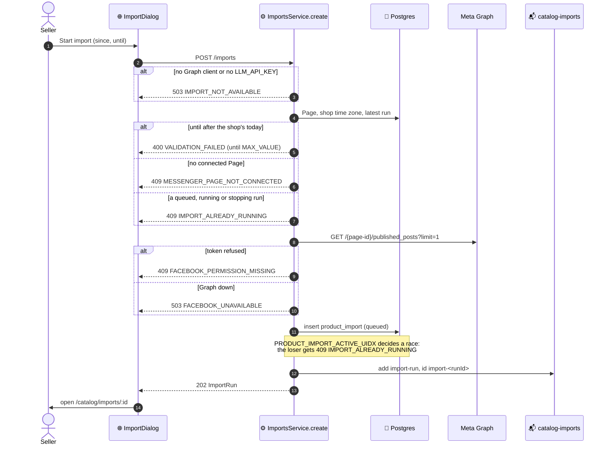
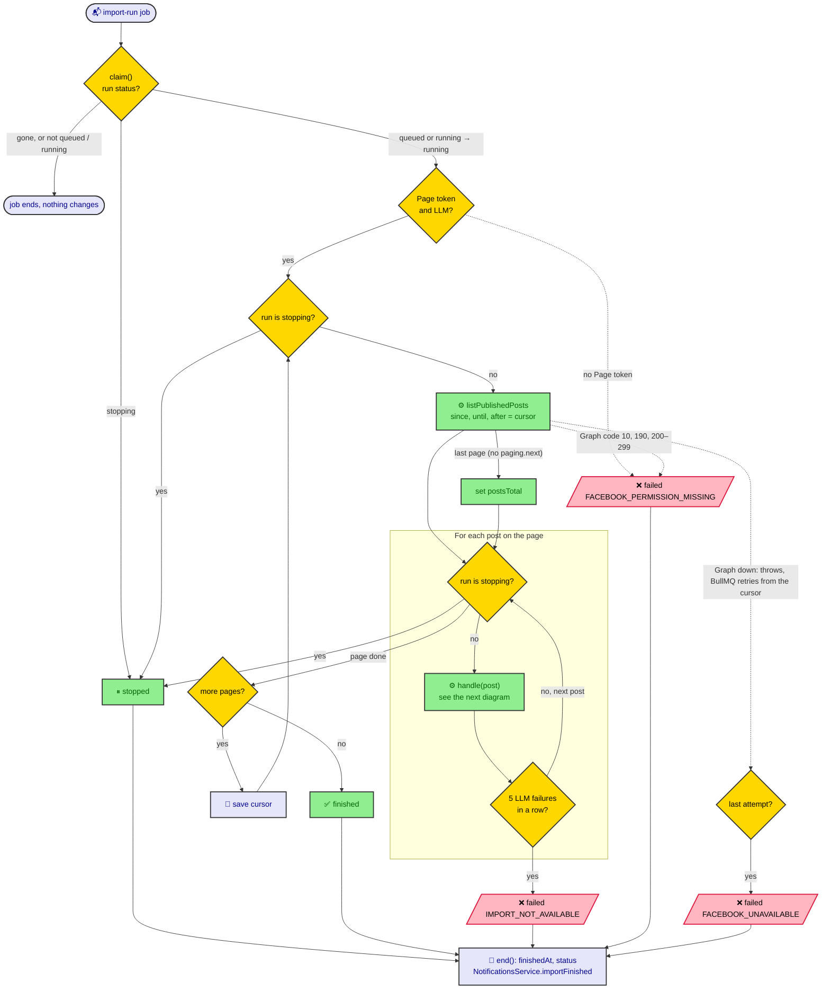
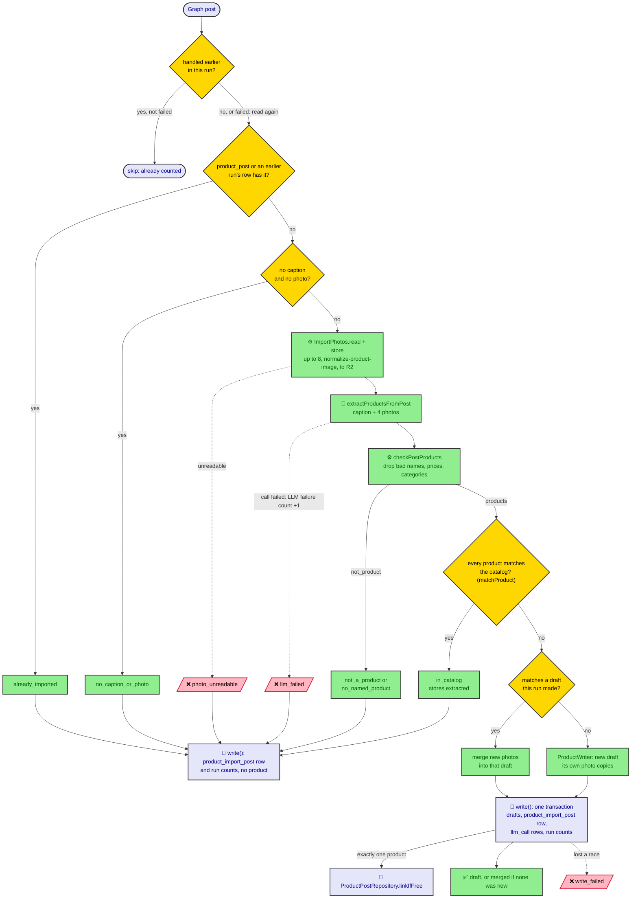

# Import flow

How a Facebook post import runs, from **Start import** to the drafts. See
[13 · Import products from Facebook posts](README.md) for the rules behind
each step.

## Starting a run

`ImportsService.create`, behind `POST /api/v1/imports`. The checks run in
this order, and the run is queued only once all of them pass.

## The run

`ImportsProcessor` hands the `import-run` job to `ImportRunner.run`. Each
Graph page is read in turn, and the cursor is saved after each one, so a
retried or resumed job carries on from the page it was on.

A run that fails keeps the drafts it already made. A run stopped before its
job starts ends as `stopped` in `claim()`, without reading Graph.

## One post

`ImportRunner.handle`. Every branch ends in `write()`, one short
`withMerchant` transaction that records the post's `product_import_post` row
and moves the run's counts. No transaction is open during the photo
download, the R2 upload or the LLM call.

Any LLM call that returns resets the run's failure count to 0. A product
that matches the catalog is left out of a post that still has new ones, and
the post's `matched_product_ids` keeps it. **Import anyway** runs the same
matching in `ImportRunner.importAnyway`; see
[Import anyway](README.md#import-anyway).
